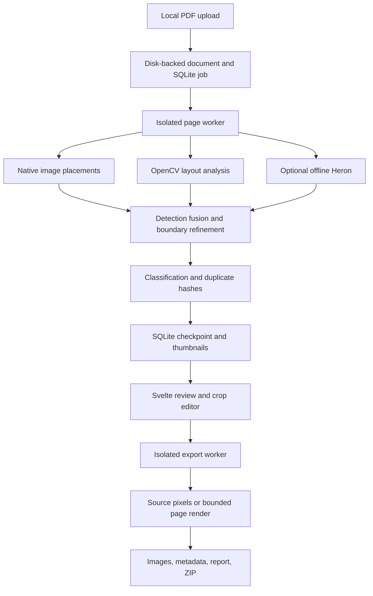

# PDF-Image-Extractor

A private, local PDF photograph extraction and review application for macOS on Apple Silicon. A Svelte 5 interface is served by FastAPI on localhost. Documents never leave your computer.

Extract individual photographs from photography books, portfolios, magazines, catalogues, and scanned or flattened PDFs. Recover embedded source pixels when available, review uncertain detections, adjust crops, and export separate image files with an extraction report.

**Validated baseline:** macOS on Apple Silicon, Python 3.12, Svelte 5, native PDF extraction and OpenCV. The application runs without AI models. Windows launchers are included but have not been exercised on a native Windows host. Real-book detection accuracy has not been established; the measured benchmark uses generated fixtures.

## Contents

- [Features](#features)
- [Quick start on macOS](#quick-start-on-macos)
- [Windows double-click launchers](#windows-double-click-launchers)
- [Requirements and installation](#requirements-and-installation)
- [Processing modes](#processing-modes)
- [Using the application](#using-the-application)
- [Keyboard shortcuts](#keyboard-shortcuts)
- [Image quality and export](#image-quality-and-export)
- [Settings and storage](#settings-and-storage)
- [Optional Heron layout engine](#optional-heron-layout-engine)
- [Architecture](#architecture)
- [Project structure](#project-structure)
- [Privacy and local API security](#privacy-and-local-api-security)
- [Validation and measured performance](#validation-and-measured-performance)
- [Development](#development)
- [Known limitations](#known-limitations)
- [Troubleshooting](#troubleshooting)
- [Third-party licenses](#third-party-licenses)

## Features

| Area | Implemented behavior |
| --- | --- |
| Import | Drag and drop or browse; multiple PDFs; streaming uploads up to 4 GB per file; password-protected PDF handling |
| Native extraction | Embedded image placements, XREFs, source dimensions, repeated placements, rotation, masks, and verified source-pixel cropping |
| Flattened pages | Adaptive background analysis, contours, texture, projection profiles, recursive gutter splitting, and multiscale detection |
| Detection review | Accepted, needs-review, and recoverable rejected regions; heuristic scores and reasons; engine availability displayed explicitly |
| Crop editor | Three-panel page workspace, zoom, pan, fit controls, draggable edges/corners, numeric bounds, manual regions, vertical split, merge, and persisted undo/redo |
| Asset browsing | Page filters, lazy thumbnails, paginated gallery, review queue, sorting, multiple selection, and large image previews |
| Long jobs | Persistent SQLite checkpoints, page-by-page workers, pause/resume/cancel, failed-page retry, time/memory limits, and live progress |
| Duplicates | Encoded-byte hashes, decoded-pixel hashes, and perceptual similarity; optional exact-duplicate skipping |
| Export | PNG, JPEG, or original format; selected/accepted/review/all/page-range scopes; naming controls; local folders, manifests, reports, and ZIPs |
| Appearance | Dark, light, and system themes; keyboard controls; focus management in settings and export dialogs |
| Optional AI | Separately installed Docling Heron layout adapter with offline inference and device fallback |

Detection is conservative rather than a guarantee that every proposed region is a photograph. Scores are detector heuristics, not accuracy percentages. Review uncertain regions before a final export.

## Quick start on macOS

Install **Python 3.12** and **Node.js 22.12+** first, then run:

```sh
git clone https://github.com/Xarnder/PDF-Image-Extractor.git
cd PDF-Image-Extractor
./setup.sh
./start.sh
```

Setup installs the Python environment and builds the frontend. The Git repository does not contain a preinstalled virtual environment or compiled frontend.

**After setup, double-click:** open `Start PDF Image Extractor.command` in Finder. It starts the app in Terminal and opens Chrome. Keep that Terminal window open; press Ctrl+C to stop. You can also launch it from the project folder:

```sh
./start.sh
```

Chrome opens automatically; the default browser is used if Chrome is unavailable. The default URL is `http://127.0.0.1:8765`. If that port is occupied, the launcher chooses a free port and opens the correct URL. Keep the terminal open. Press Ctrl+C or run `./stop.sh` to stop.

For a background session:

```sh
./start.sh --background
./stop.sh
```

Add `--no-browser` when you do not want a browser window. An existing instance is reused. The launcher verifies its own server process before stopping it.

## Windows double-click launchers

Double-click **`start.bat`** or **`start.cmd`** in the project folder. Both run the same Windows helper. Install Python **3.12** first. On first launch the helper creates `.venv-windows` and installs the pinned core dependencies; it does not reuse the Mac virtual environment. Internet access is required for that first installation. If the compiled frontend is missing, install Node.js **22.12+** as well; the helper installs frontend dependencies and builds it automatically.

The helper binds only to localhost, selects a free port, waits for server startup, and opens Chrome (or the default browser). Keep its console open and press **Ctrl+C** to stop. Errors stay visible. Later launches reuse the local installation and can run offline. Do not copy `data/state.sqlite3` from a different computer: existing jobs store absolute PDF paths; import PDFs on the destination machine.

The `.bat` and `.cmd` files are Windows files and do not run natively on macOS. Their Windows execution has not been tested on a Windows host; use the `.command` file on this Mac. Windows ARM64 wheel availability is not validated.

For a fresh Windows clone, install Python 3.12 and Node.js 22.12+, then use Command Prompt:

```bat
git clone https://github.com/Xarnder/PDF-Image-Extractor.git
cd PDF-Image-Extractor
start.cmd
```

Once cloned, double-clicking either launcher has the same effect. On first start, installation and frontend compilation can take several minutes. A failed setup leaves an error message visible; fix the missing prerequisite and run it again.

## Requirements and installation

The primary target is macOS 14 or newer on Apple Silicon. The core may run on other platforms, but the dependency lock was validated on macOS ARM64 only.

| Requirement | Details |
| --- | --- |
| Python | **3.12**; isolated in `.venv` on macOS or `.venv-windows` on Windows |
| Node.js | **22.12+** for installing, checking, or rebuilding the frontend; not needed to serve an existing production build |
| Browser | Google Chrome preferred; launcher falls back to the default browser |
| Storage | At least 2 GB free for initial dependencies, plus room for PDFs, previews, exported images, and ZIP copies |
| GPU | Not required for the core; CPU extraction is the tested baseline |
| Network | Required for dependency installation and explicit optional model downloads; normal processing works offline |

If prerequisites are missing, install Python 3.12 and Node 22 LTS from their official installers or Homebrew. Setup never changes system Python.

```sh
./setup.sh
./doctor.sh
./start.sh
```

Setup creates `.venv`, installs `backend/requirements.lock`, runs `npm ci`, checks TypeScript/Svelte, builds the production frontend, and verifies PDF rendering and hardware. `PDF_EXTRACTOR_PYTHON=/absolute/path/to/python3.12 ./setup.sh` selects a Python interpreter explicitly. This checkout was installed with the available Codex Python 3.12 runtime; another machine can use its own Python 3.12.

After setup, normal extraction and export work offline. Only setup, optional runtime installation, and explicitly initiated model downloads use the network. Fonts and icons are bundled locally.

## Processing modes

| Mode | Engines and intended use |
| --- | --- |
| **Native only** | Embedded-image inspection without rendered-page layout detection. Useful when each photograph is a separate image object. Page-sized sources are retained for review. |
| **Fast** | Native extraction plus OpenCV. No AI dependencies or model weights are required. |
| **Balanced** (default) | Native extraction and OpenCV, with Heron proposals when the model is installed and enabled. |
| **Maximum accuracy** | Additional OpenCV analysis at another scale and tiled Heron inference when enabled. It costs more time and still requires review of difficult layouts. |

Choose the mode before importing. A job keeps its processing settings when paused or resumed. Maximum accuracy does not silently install models or enable an unavailable secondary engine. The workspace identifies the engines and device actually used.

## Using the application

1. Drop one or more PDFs onto the dashboard or choose **Browse files**. Choose a processing mode before importing. For an encrypted PDF, expand **Protected PDF?** and enter its password first. The password is not stored; an unlocked local working copy is retained. On macOS its file permissions are restricted to the current user; on Windows, access also depends on the folder's inherited permissions.
2. Choose **Start extraction**. Multiple documents are queued automatically. Balanced is the default. Fast uses native images and OpenCV; Maximum adds multiscale detection and tiled Heron when enabled. Native only retains page-sized images for review instead of silently accepting them as photographs.
3. Follow page checkpoints and actual processing progress. Pause finishes the current page; cancellation stops it and keeps completed pages. Resume continues pending pages. Failed pages have explicit errors and a retry action. Restarting after an interruption leaves the job paused and resumable.
4. Select a region to inspect its source dimensions, estimated output, extraction method, heuristic detection score, and notes. Green means accepted, amber means review, red means rejected, and blue indicates selection. A score is **not a measured probability of accuracy**.
5. Drag a crop or its handles to adjust it. The + tool draws a new crop. Shift-click selects multiple regions. Split divides a crop vertically; merge creates a union crop and retains the previous regions as rejected. Coordinates remain in displayed PDF points at every zoom. Numeric coordinates can be edited in the inspector. Undo/redo and manual edits are saved in SQLite. Re-detection preserves manually edited and rejected regions.
6. Use the gallery for document-wide selection, sorting, bulk acceptance/rejection/restoration, and full-resolution viewing. The review queue supports `A` to accept, `R` to reject, `[` / `]` to navigate photographs, and arrow keys for page navigation. `Cmd+Z` / `Cmd+Shift+Z` undo/redo.
7. Export accepted images, selected images, a page range, review-only regions, or all regions including rejected ones. Every export creates a new local folder, `metadata.json`, `extraction_report.json`, and a downloadable ZIP. Review and rejected regions go in separate subfolders. Files are written atomically; existing exports are never overwritten.

### Review colors and page filters

| Color | Meaning |
| --- | --- |
| Green | Accepted photograph |
| Amber | Needs review |
| Red | Rejected region, still recoverable |
| Blue | Current selection |

Filter pages by all, unprocessed, completed, needs review, failed, or no photographs. If detection misses an image, draw a new rectangle with the **+** tool. If adjacent photographs were combined, split the region or draw separate crops. Rejecting a region does not erase it; restore it to review from the inspector or gallery.

### Interruption and recovery

Completed page results are checkpointed as processing proceeds. Pause lets the current page finish. Cancel stops current work and preserves completed pages. An unexpected application exit leaves an interrupted job paused on restart; open the document and resume it. Failed pages carry explicit errors and have a retry action.

Keep the app's terminal open while it processes or exports. Prefer Ctrl+C or `./stop.sh` on macOS over force-quitting. Export interruptions retain files already written, but the export should be retried into a new output folder.

## Keyboard shortcuts

Shortcuts apply in the workspace when a form field is not being edited.

| Shortcut | Action |
| --- | --- |
| `A` | Accept selected regions |
| `R`, `Delete`, or `Backspace` | Reject selected regions |
| `[` / `]` | Previous / next region in the current view |
| `←` / `→` | Previous / next page |
| `Cmd+Z` / `Ctrl+Z` | Undo |
| `Cmd+Shift+Z` / `Ctrl+Shift+Z` | Redo |
| `Shift-click` | Select multiple regions |
| `Escape` | Clear selection or close a preview/dialog |

## Image quality and export

| Output | Behavior |
| --- | --- |
| **Original** | Copies original encoded bytes when the requested composition, orientation, resolution, and metadata settings permit; otherwise falls back to PNG |
| **PNG** | Lossless output after decoding/cropping; supports transparency |
| **JPEG** | Quality 1–100, default 98, with 4:4:4 chroma sampling; composites transparency against the configured background color |

Extraction preferences are **Automatic**, **Complete embedded source**, and **As displayed in PDF**. Automatic uses source pixels when verified against the visible page and otherwise renders the region. Complete source can recover parts of an embedded image that the PDF hides. Displayed mode uses the page's appearance, including its composition and clipping.

Original export copies encoded source bytes when composition, orientation, metadata preference, and requested resolution permit. Crops and transformations use source pixels when safe. Other cases use a bounded page render. PNG is lossless; JPEG defaults to quality 98 with 4:4:4 sampling. Original export falls back to PNG where original bytes cannot represent the selected result. DPI is a fallback rendering setting or an optional downsampling target; raster images are not deliberately upscaled. Choose **Complete embedded source** to recover the uncropped original; manual crop boundaries still take precedence.

The default output folder is `data/exports`. Enter an absolute directory in **Settings → Export & storage** to change it. Files use deterministic page and image ordering. Exact duplicate removal is opt-in and compares decoded pixels; similar-image flags are advisory. Identical encoded sources and distinct placements remain distinguishable in the manifest.

Each export includes:

- Separate image files, with optional `needs_review/` and `rejected/` subfolders.
- `metadata.json`: source fingerprint, settings, region records, output filenames/dimensions, and extraction methods.
- `extraction_report.json`: job summary, exported count, skipped exact duplicates, and failed pages.
- A ZIP downloadable from the workspace; the image folder remains available independently.

Source-aware resolution is the default. Target DPI offers 150, 200, 300, 400, 600, and a custom value within the configured 72–1200 range. Rendering falls back to 300 DPI by default. Higher DPI does not create detail absent from a raster source, and the pixel cap may reduce a large render. Metadata can be preserved or stripped; color profiles are retained where available for faithful appearance. No sharpening, denoising, enhancement, or AI upscaling is applied.

## Settings and storage

Processing thresholds, padding, refinement, duplicate distance, worker count, per-worker memory, page timeout, pixel limits, export quality, output directory, automatic export, and theme are configurable. Each imported job captures its settings, so changing defaults does not silently alter an existing job. Re-import a document to apply a different detection mode or threshold set.

| Default | Value |
| --- | ---: |
| Processing mode | Balanced |
| Concurrent document workers | 1 (configurable from 1 to 4) |
| Memory limit per worker | 2048 MB |
| Page timeout | 120 seconds |
| Maximum decoded pixels | 60,000,000 |
| Minimum source dimension | 80 pixels |
| Minimum page area | 0.004 (0.4%) |
| Crop padding | 0 PDF points |
| Export format | PNG |
| JPEG quality | 98 |
| Fallback render DPI | 300 |
| Optional AI | Disabled |
| Exact duplicate skipping | Disabled |

| Location | Contents |
| --- | --- |
| `data/documents` | Local PDF working copies |
| `data/state.sqlite3` | Jobs, pages, regions, edits, settings, export history |
| `data/cache` | Lightweight page and photograph previews |
| `data/exports` | Default output folders and ZIPs |
| `models/heron` | Optional offline model snapshot and revision |
| `logs/app.log` | Structured page events and server errors |
| `logs/launcher.log` | Background startup output |

Set `PDF_EXTRACTOR_DATA=/absolute/local/folder` **before starting** to relocate document storage, checkpoints, previews, and default exports together. This selects a separate data store; it does not move an existing one. The worker memory setting is per process, not a whole-machine limit. Default: one document worker, 2 GB per worker, 60 million decoded pixels, 120 seconds per page. A separate serialized worker serves rendering requests; exports use one isolated worker and a bounded queue of 32 waiting jobs.

Removing a document on the dashboard deletes its PDF/cache/checkpoints but keeps exported files. Interrupted upload fragments are cleaned on startup. Model files are never deleted automatically. Synthetic benchmark files live under the ignored `tests/generated` directory.

To use another data folder on macOS:

```sh
PDF_EXTRACTOR_DATA="$HOME/PDF-Extractor-Data" ./start.sh
```

Stop the application before making backups of the data directory. Keep its document files and SQLite state together. Jobs contain absolute paths, so moving only the database to another machine does not migrate their PDFs. Import documents afresh when changing computers. The data, caches, dependencies, model weights, logs, and generated benchmark files are excluded from Git.

## Optional Heron layout engine

The base installation does **not** include PyTorch or model weights. No AI or GPU processing is claimed in the installed baseline. Heron uses the official Docling model through its documented Transformers inference API without loading Docling's OCR/table pipeline.

```sh
./scripts/install-ai.sh
```

This explicitly installs the optional runtime; it does not fetch model weights. Restart, open **Settings → AI models**, and choose **Download Heron (~173 MB)**. The model revision is resolved and recorded during that explicit download. Enable it for new Balanced/Maximum jobs. Subsequent inference uses `local_files_only=True` with Hugging Face offline mode and telemetry disabled. Device selection checks MPS/CUDA availability and falls back to CPU on model/device errors; a model failure is surfaced in job notices while core detection continues.

The adapter and fallback paths have automated tests, but **real Heron inference and MPS performance were not validated in this checkout**, because no optional runtime or weights were installed. The UI distinguishes dependency presence from installed weights. DocLayout-YOLO, PP-DocLayoutV3, Apple Vision and CLIP/SigLIP classification are explicitly not integrated. They can be added behind the detector interface after independent compatibility and accuracy testing.

Official references and dependency decisions are in [docs/architecture.md](docs/architecture.md).

## Architecture

The compiled Svelte frontend and FastAPI API are served from one loopback origin. There is no separate frontend server during normal use and no external database.



Key implementation decisions:

- **Process isolation:** PDF documents are opened inside reusable spawned workers; PyMuPDF handles are never shared between threads. Time/memory watchdogs replace failed workers.
- **Page checkpoints:** each completed page commits its detections and state together in SQLite WAL mode. Recovery resumes from stored results.
- **Bounded work:** configurable document slots, a serialized preview/import worker, and one export worker with a queue of up to 32 waiting exports.
- **Coordinate consistency:** crop bounds use displayed PDF points, including page rotation. Zoom and pan are UI transforms over those coordinates.
- **Quality preservation:** verified source pixels take precedence over rendering; unchanged encoded images can pass through without recompression.
- **Separable detectors:** native, OpenCV, optional AI, fusion, refinement, classification, and export live in distinct modules behind proposal interfaces.

See [architecture and dependency decisions](docs/architecture.md) for the detailed pipeline, concurrency model, model references, and extension points.

## Project structure

```text
PDF-Image-Extractor/
├── backend/
│   ├── app/
│   │   ├── api/                 FastAPI routes and local security
│   │   ├── core/                Validated settings and filesystem helpers
│   │   ├── database/            SQLite schema, persistence, and queries
│   │   ├── extraction/          Detectors, image processing, and export
│   │   ├── jobs/                Scheduler and isolated worker supervision
│   │   └── services/            Persistent edits and export jobs
│   ├── tests/                   Backend integration and extraction tests
│   ├── requirements.lock        Pinned core Python dependencies
│   └── requirements-ai.txt      Optional inference dependencies
├── frontend/
│   ├── src/                     Svelte 5, TypeScript, CSS, and coordinate tests
│   ├── package.json
│   └── package-lock.json
├── scripts/                     Setup, launch, diagnosis, and optional AI setup
├── tests/                       Synthetic PDF fixtures and stress benchmark
├── docs/                        Architecture, validation, measured benchmark
├── data/                        Runtime documents, database, cache, exports
├── models/                      Optional downloaded model weights
├── logs/                        Local application logs
├── Start PDF Image Extractor.command
├── setup.sh / start.sh / stop.sh / doctor.sh
└── start.bat / start.cmd
```

## Privacy and local API security

PDF parsing, detection, previews, review, and export run on the local machine. Document contents and photographs are not sent to a cloud service. There are no analytics requests, remote fonts, or paid API dependencies. Only dependency installation and explicit model downloads require network access.

The server binds to `127.0.0.1`. API requests are protected with Host validation, same-origin and Fetch Metadata checks, and an unpredictable session token for mutations. Responses include a restrictive content security policy and frame denial. Uploads check PDF signatures, limit size, sanitize filenames, and use disk-backed working files. Per-worker memory/time limits and render pixel limits bound malformed or oversized inputs. Embedded PDF JavaScript is not executed.

This is a local single-user application. Do not expose its port through a public tunnel or use it as a multi-user network service. Anyone with access to the local data directory can access its saved PDFs and exports; protect that folder with the operating system's normal account and disk controls.

## Validation and measured performance

Latest recorded checks on the development Mac:

- **33 backend tests passed**, covering native/flattened extraction, crop geometry, masks, clipping, image rotation/color spaces, metadata, duplicate hashes, exports, persistence, worker recovery, security, and launcher helper behavior.
- **8 frontend tests passed**, checking coordinate mapping at different zoom levels, panning, and reverse crop drawing.
- **0 Svelte/TypeScript errors or warnings**, with a successful production build.
- Chrome exercised import, real processing, page review, crop splitting, undo, and keyboard acceptance. Additional editing, export, theme, and accessibility checks were performed in the in-app browser.

### Synthetic 174-page benchmark

The benchmark contains seven layouts, alternating native and flattened test images, narrow gutters, white/dark/colored paper, page rotations, full-page images, and empty pages. These are generated textured test assets, not a real photography publication.

| Metric | Measured result |
| --- | ---: |
| Pages processed / failed | 174 / 0 |
| Expected / detected / matched regions | 425 / 425 / 425 |
| Missed / extra regions | 0 / 0 |
| Precision / recall on this fixture | 1.000 / 1.000 |
| Mean bounding-box IoU | 0.99946 |
| Maximum matched edge error | 0.420 PDF points |
| Processing time, including forced restart | 49.18 seconds |
| Throughput | 3.54 pages/second |
| Peak sampled server + worker RSS | 1035.7 MB |
| Health API latency, 95th percentile | 1.45 ms |
| Valid individual PNG exports | 425 |
| Export time | 25.45 seconds |

The server was forcibly terminated after 14 completed pages and successfully resumed from its checkpoint. Every exported image was opened and verified. The run used one document worker with optional AI disabled. Memory figures exclude the browser and fixture generator.

**These figures measure only the synthetic fixture. They are not real-world accuracy guarantees.** No actual 174-page book was provided or validated. See the full [validation report](docs/validation.md) and machine-readable [benchmark results](docs/benchmark.json).

### Run the checks

From the repository root after setup on macOS:

```sh
PYTHONPATH=backend .venv/bin/python -m pytest backend/tests -q
npm --prefix frontend run check
npm --prefix frontend test
npm --prefix frontend run build
PYTHONPATH=backend .venv/bin/python tests/stress_test.py
```

The stress command creates files under `tests/generated`, runs a separate local API server, deliberately kills/restarts its process group, exports all regions, and updates `docs/benchmark.json`. Allow several gigabytes of free space for generated inputs and outputs. The stress runner uses Unix process-group signals and is not a Windows test command. Re-running it produces new timings on your hardware.

## Development

Normal use needs only the production launcher. For frontend development, run the backend normally and start Vite in another terminal:

```sh
# Terminal 1: from the repository root
./start.sh --no-browser

# Terminal 2: from the repository root
npm --prefix frontend run dev
```

Open the URL printed by Vite. Its `/api` proxy targets `127.0.0.1:8765`; if the launcher selects a different port, update the proxy in `frontend/vite.config.ts` before starting Vite. Keep the application origin and backend proxy aligned with the local security checks. Restart the backend after Python changes. Run `npm --prefix frontend run build` to update the normal launcher UI after frontend changes.

The repository includes lockfiles for Python and npm. Add optional engines behind the detector interface and keep the no-AI startup path working. New detection changes should include generated fixtures with known boundaries and should report false positives, misses, boundary errors, and resource usage. Do not commit real documents, local database files, model weights, exports, or dependency folders.

## Known limitations

- Traditional visual analysis cannot reliably classify all illustrations, book mockups, advertisements, or low-detail photographs. Uncertain candidates remain recoverable in review. A textured illustration can still look photographic to the heuristic classifier. Inspect outputs for important work.
- Flattened photographs with white interiors, invisible borders, textured backgrounds, overlapping images, or no gutters may require manual correction. Native image boundaries preserve photographic white backgrounds; the same information does not exist in a flattened scan.
- Orthogonal native placements support source cropping, rotation and mirroring. Single-source rectangular clipping is handled directly when verified. Complex clipping paths, opacity, masks, skew and overlapping paint use rendering; their proposed rectangular boundaries may need review. Preview comparison is conservative but cannot prove equality of sub-preview-pixel content.
- Crop editing is rectangular. Polygon editing, OCR, automatic semantic photograph classification and automatic content enhancement are not implemented.
- A target render larger than the configured pixel cap is reduced to stay bounded. An oversized source is flagged for rendering/review; explicit full-source export refuses it rather than exhausting memory.
- Original encoded bytes can only pass through when metadata stripping does not require a rewrite. PNG/JPEG conversion handles RGB, CMYK, grayscale and alpha; unusual or damaged profiles fall back to Pillow conversion. This is not a colour-proofing workflow.
- This is an unpackaged local application, not a signed/notarized macOS app. The shell launcher is macOS/Linux-specific. Windows has a separate bootstrap/launcher, but still needs native Windows execution and dependency-lock validation.
- The supplied screenshot is an illustrative UI reference, not the actual 174-page PDF or a photographic detection fixture. No successful real-book accuracy claim is made.

## Troubleshooting

Run `./doctor.sh` first on macOS. It checks Python, installed core packages, PDF rendering, OpenCV, storage, the frontend build, and optional device/model availability.

| Symptom | Action |
| --- | --- |
| Python or Node is missing | Install the versions in the requirements table, then rerun setup. Use `PDF_EXTRACTOR_PYTHON` to select Python 3.12 explicitly on macOS. |
| Startup asks to run setup | Run `./setup.sh` from the repository root before using a macOS launcher. A fresh clone contains source files, not installed dependencies. |
| Port 8765 is busy | The launcher chooses another port. Use the URL it prints or the browser tab it opens. |
| Blank or outdated interface | Rebuild with `npm --prefix frontend run build`, restart, and reload the browser. |
| Invalid local session token after restart | Reload the browser to obtain the new session token. |
| Optional AI is unavailable | The base application still works. Install the optional runtime and download weights explicitly if needed. |
| A page times out or exceeds memory | Inspect its page error. Retry transient failures; adjust resource defaults and re-import if different job limits are needed. |
| Crops include gutters or miss photographs | Adjust bounds, split regions, or draw a manual crop. Try Maximum accuracy on a newly imported job. |
| Export fails | Read the reported error and check free space/output-folder permissions. Completed images remain in the unique export folder. Retry as a new export. |
| Windows setup fails | Keep the console open and read its error. Check Python 3.12, Node 22.12+, internet access for setup, and platform wheel availability. Native Windows support remains unverified. |
| A moved database cannot find documents | Jobs store absolute PDF paths. Use the original data location or import the documents again on the new machine. |

For diagnostics, inspect `logs/app.log` and, for macOS background startup, `logs/launcher.log`. Logs may contain filenames and local paths, so review them before sharing an issue. Include the processing mode, page error, platform, and a minimal synthetic reproduction when reporting a bug.

## Third-party licenses

PyMuPDF is an AGPL/commercial dual-licensed dependency. See [THIRD_PARTY_NOTICES.md](THIRD_PARTY_NOTICES.md) before redistributing or packaging this application.

The repository contains fixture generators rather than third-party photographs. Optional weights are downloaded separately and retain their upstream license terms. See the dependency lockfiles and installed package metadata for exact packages and licenses.
